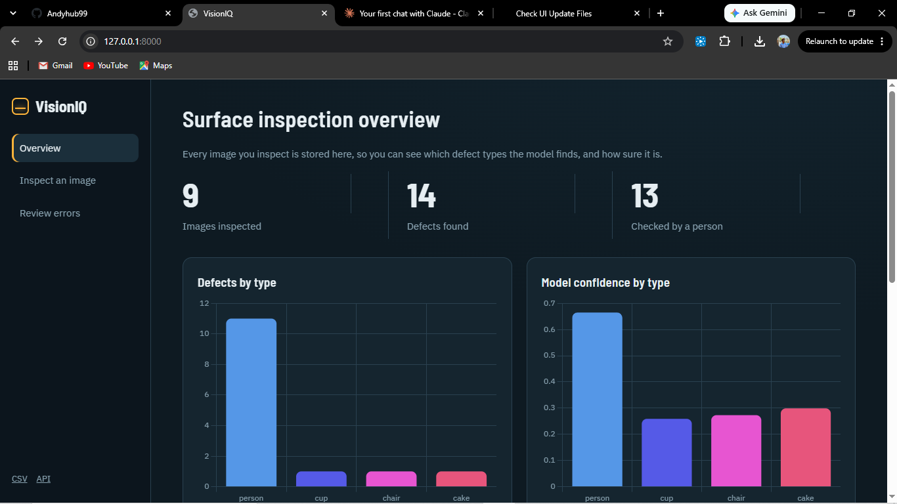
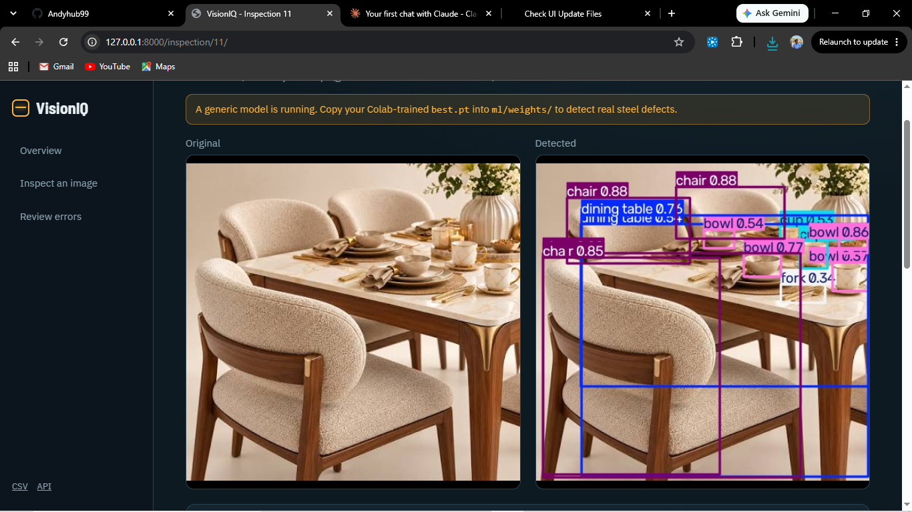
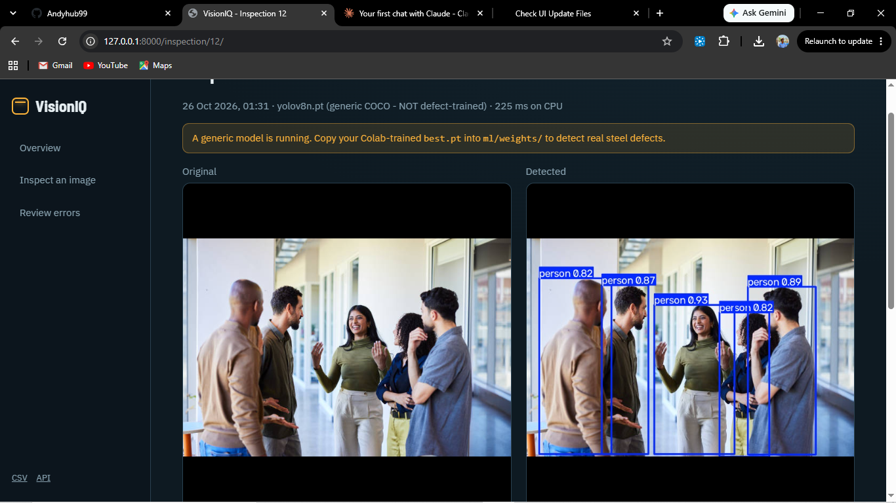
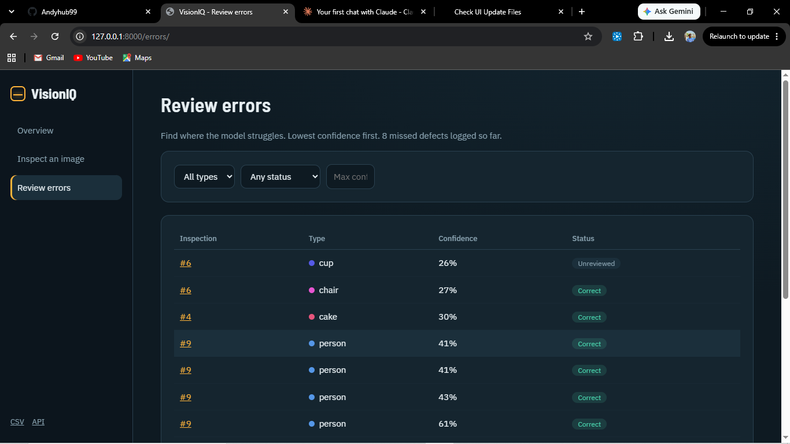
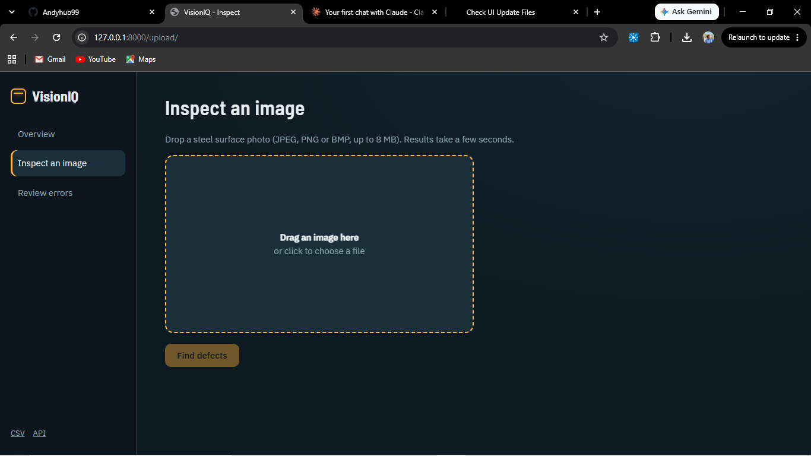

# VisionIQ — AI-Powered Steel Surface Defect Inspection

[](https://visioniq-a15k.onrender.com)
[](https://www.python.org/)
[](https://www.djangoproject.com/)
[](https://docs.ultralytics.com/)
[](https://render.com/)

**VisionIQ** is a full-stack computer-vision application for inspecting steel surface images, detecting potential defects, and organizing inspection results through a web interface.

It combines a Django application, a YOLO-based detection pipeline, inspection records, human review workflows, analytics, and machine-learning training utilities in one portfolio project.

**Live demo:** https://visioniq-a15k.onrender.com  
**Source code:** https://github.com/Andyhub99/VisionIQ

> **Demo note:** The application is hosted on Render's free web service, which may sleep when inactive. The first request can take a while to respond. Detection and model loading should be verified on the live deployment before relying on it for real inspections.

## Table of contents

- [Overview](#overview)
- [Features](#features)
- [Supported defect classes](#supported-defect-classes)
- [Technology stack](#technology-stack)
- [Architecture](#architecture)
- [Project structure](#project-structure)
- [Run locally](#run-locally)
- [Environment variables](#environment-variables)
- [Machine-learning workflow](#machine-learning-workflow)
- [Testing](#testing)
- [Deployment on Render](#deployment-on-render)
- [Limitations and responsible use](#limitations-and-responsible-use)
- [Future improvements](#future-improvements)

## Overview

Steel surface inspection is an important quality-control task in manufacturing. Manual inspection can be time-consuming, and defects may be difficult to identify consistently across large volumes of images.

VisionIQ explores how computer vision can assist this process by identifying candidate defect regions and presenting results for human review.

The application is designed as a complete engineering project rather than an isolated model-training notebook. It connects model inference with a web application, stored inspection records, review workflows, analytics, and deployment configuration.

## Features

### AI-assisted defect detection
- YOLO-based steel surface image inference.
- Bounding boxes and confidence scores for detected regions.
- Annotated image output for visual inspection.
- Configurable confidence threshold.
- Explicit loading of the trained defect model instead of silently substituting a generic object-detection model.

### Inspection management
- Image-based inspection workflow.
- Stored inspection records and detection results.
- Human review of model predictions.
- Review-oriented inspection history.

### Analytics and reporting
- Inspection dashboard and summary analytics.
- Error Explorer for investigating detection results.
- CSV export for downstream analysis and tools such as Power BI.

### Backend and machine-learning tools
- Django web application.
- Django REST Framework integration.
- Automated tests for important application behavior.
- Dataset preparation, training, evaluation, and robustness scripts designed for Google Colab workflows.

## Supported defect classes

The project uses the six-class NEU-DET steel surface defect taxonomy:

| Class | Description |
|---|---|
| `crazing` | Fine crack-like surface patterns |
| `inclusion` | Foreign material or inclusions |
| `patches` | Patch-like surface defects |
| `pitted_surface` | Small pits or cavities on the surface |
| `rolled-in_scale` | Scale pressed into the steel surface |
| `scratches` | Linear surface marks |

The model's actual predictions depend on the trained weights, dataset quality, and inference threshold. These labels do not guarantee that every defect will be detected correctly.

## Technology stack

| Component | Technology |
|---|---|
| Backend | Python, Django |
| API | Django REST Framework |
| Computer vision | Ultralytics YOLO, OpenCV |
| Image processing | Pillow, NumPy |
| Database | SQLite for local development; PostgreSQL configured for deployment |
| Static assets | WhiteNoise and Django static files |
| Production server | Gunicorn |
| Hosting | Render |
| ML experimentation | Google Colab and Python training scripts |
| Testing | pytest, pytest-django |

## Architecture

```text
User
 |
 v
Django Web Application
 |
 +--> Image Upload and Validation
 |
 +--> YOLO Detection Service
 |       |
 |       +--> Trained Model Weights
 |       +--> Bounding Boxes and Confidence Scores
 |       +--> Annotated Image
 |
 +--> Inspection Records
 +--> Human Review Workflow
 +--> Analytics and CSV Export
 |
 v
Database and Web Interface
```

The detector loads its model lazily so that the model is not initialized unnecessarily when Django starts. The configured trained weights are expected at `ml/weights/best.pt` unless `MODEL_PATH` is overridden.

## Project structure

```text
VisionIQ/
├── config/                 # Django project settings and URL configuration
├── inspections/            # Inspection and detection application
├── ml/
│   ├── weights/
│   │   └── best.pt         # Trained defect-detection weights
│   ├── metrics.json        # Model metrics, if present in this checkout
│   └── ...                 # Dataset and ML utilities
├── docs/
│   └── screenshots/        # Project screenshots, if present
├── prepare_neudet.py       # Dataset preparation utility
├── train_colab.py          # Colab-oriented training workflow
├── robustness.py           # Robustness evaluation utility
├── requirements.txt
├── build.sh                # Render build and migration commands
├── render.yaml             # Render Blueprint configuration
├── manage.py
└── README.md
```

Some generated dataset and training-output directories are intentionally excluded from Git to avoid committing large or reproducible artifacts.

## Run locally

### 1. Clone the repository

```powershell
git clone https://github.com/Andyhub99/VisionIQ.git
cd VisionIQ
```

### 2. Create a virtual environment

Python 3.13 is the version used in the current Windows development environment.

```powershell
py -3.13 -m venv .venv
.\.venv\Scripts\Activate.ps1
python -m pip install --upgrade pip
```

### 3. Install dependencies

```powershell
pip install -r requirements.txt
```

### 4. Configure environment variables

If `.env.example` exists in the repository, copy it:

```powershell
Copy-Item .env.example .env
```

Set appropriate local values in `.env`. Never commit secrets or production credentials.

### 5. Apply database migrations

```powershell
python manage.py migrate
```

### 6. Start the development server

```powershell
python manage.py runserver
```

Open http://127.0.0.1:8000 in your browser.

If you need an administrator account and the project supports Django's standard admin, create one with:

```powershell
python manage.py createsuperuser
```

### Model weights

The default model path is:

```text
ml/weights/best.pt
```

The repository includes trained weights. If the file is missing, detection intentionally raises a clear error rather than silently using generic COCO weights that are not trained for the project's steel defect classes.

## Environment variables

The Django application and Render configuration use environment variables for deployment-specific settings.

| Variable | Purpose |
|---|---|
| `DJANGO_SECRET_KEY` | Django secret key; set a secure value in production |
| `DJANGO_DEBUG` | Enables or disables Django debug mode |
| `DJANGO_ALLOWED_HOSTS` | Comma-separated allowed hostnames |
| `CSRF_TRUSTED_ORIGINS` | Comma-separated trusted origins, when required |
| `DATABASE_URL` | Database connection URL; configured for PostgreSQL on Render |
| `MODEL_PATH` | Path to the trained model weights |
| `CONF_THRESHOLD` | Detection confidence threshold |

Do not publish real secret keys, passwords, or database credentials.

## Machine-learning workflow

The repository includes utilities for preparing data and experimenting with model training outside the web application.

### Dataset preparation

`prepare_neudet.py` prepares the source dataset for the training workflow. Run its help command to see the supported arguments:

```bash
python prepare_neudet.py --help
```

The script accepts source and output paths, with an optional random seed.

### Training in Google Colab

`train_colab.py` supports the model-training workflow in Colab. A GPU-enabled Colab runtime may be more suitable for training than a standard laptop.

### Robustness evaluation

`robustness.py` provides a separate entry point for robustness experiments. Check its help output and the script's documentation for supported options:

```bash
python robustness.py --help
```

Keep generated datasets and training runs out of Git unless there is a clear reason to publish them. Record the dataset version, training configuration, and evaluation results when reporting model performance.

## Testing

Activate the virtual environment and run:

```powershell
python -m py_compile config\settings.py inspections\detector.py
python manage.py check
python -m pytest -q
```

The latest local verification before the Render deployment passed **5 tests**, and Django's system check reported no issues. Rerun the checks after making code changes.

## Deployment on Render

This repository contains `render.yaml` and `build.sh` for Blueprint-based deployment.

### Configured services

- **Web service:** `visioniq`
- **Database:** `visioniq-db` (PostgreSQL)
- **Build:** Install Python dependencies, collect static files, and apply database migrations.
- **Start:** Run Django through Gunicorn.
- **Model:** `ml/weights/best.pt`
- **Debug mode:** Disabled in the Render configuration.

### Deploy

1. Push the project to GitHub.
2. Open the [Render Dashboard](https://dashboard.render.com/).
3. Create a new Blueprint using this repository.
4. Select the `main` branch and the root `render.yaml`.
5. Review the proposed services and their plans before deploying.
6. Monitor the build and runtime logs.
7. Open the generated service URL and test the application, including model inference.

### Free-tier limitations

- Free web services can spin down when inactive, causing a delay on the next request.
- Free PostgreSQL databases have a limited lifetime and should not be treated as permanent storage.
- Files saved to an ephemeral service filesystem can disappear after a restart or redeploy.
- PyTorch and YOLO can have significant memory requirements. Confirm that model initialization and inference work within the selected instance's resource limits.

For a long-running production deployment, plan persistent or external image storage, durable database hosting, backups, monitoring, and an instance with sufficient memory.

## Limitations and responsible use

VisionIQ is a portfolio and experimental inspection project, not a certified industrial inspection system.

- Model predictions can contain false positives and false negatives.
- Confidence scores are not the same as calibrated probabilities.
- Performance depends on training data, image quality, lighting, surface conditions, and the selected threshold.
- Human review remains important before making manufacturing or safety decisions.
- Do not claim production-grade accuracy without reproducible evaluation on representative, held-out data.

## Future improvements

Potential next steps include:

- Add a health-check endpoint and deployment smoke tests.
- Publish reproducible evaluation metrics and a confusion matrix.
- Add persistent object storage for inspection images.
- Add model-version tracking and inference monitoring.
- Improve test coverage for uploads, inference errors, and API permissions.
- Add CI checks for formatting, tests, and deployment configuration.

---

## Author

**Andy** — [GitHub: Andyhub99](https://github.com/Andyhub99)

Built as a full-stack computer-vision and machine-learning portfolio project.

## License

Check the repository for a `LICENSE` file before redistributing or reusing this project. If no license is present, assume that standard copyright restrictions apply.


## Screenshots

### VisionIQ Dashboard


### Surface Defect Detection


### Surface Defect Detection


### Review Errors


### Inspect Image


